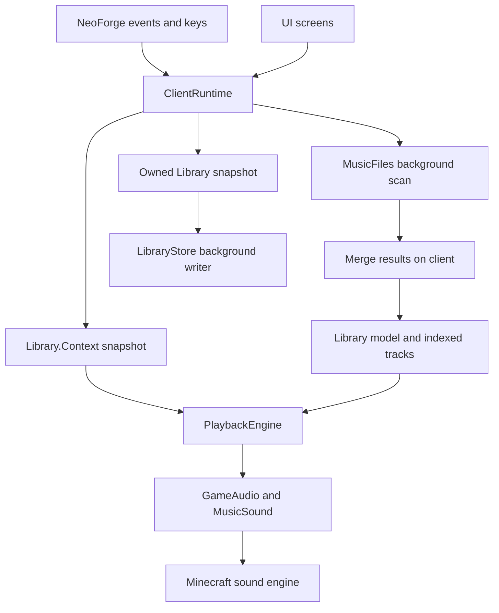

# Understanding and developing AFMR

For the **1.0.1** source, reviewed **October 23, 2026**. This guide explains how the
current implementation fits together. It is not a reconstruction of development
before Git. The imported validated baseline is tagged `v0.5.2`.

## Song groups, notification delay and player themes

`PlaybackEngine` owns group identity/count on the client. Only a natural PLAYING
completion with the same source/selection can skip an ordinary gap; queues,
previews, one-song overrides, errors, death and explicit transport reset the group.
Accepted playlist switches start a fresh group. `Settings.songsBeforeSilence` is
profile-owned; each playlist can independently select its own count. Normalization
and preset import validate 1–1000. `ShuffleBag.lastDraw` supplements the existing
per-playlist remaining order, preventing an own-last repeat across cycle boundaries.
Existing reset lifecycle clears these bags; nothing persists across launches.

`MusicSound.started` publishes one boolean from Minecraft's sound executor after
its channel is playing. `PlaybackEngine.trackElapsed()` starts then and uses the
existing unpaused playback clock. `NowPlaying` waits for the shared appearance
delay, then anchors the full existing wall-clock display duration. Style refreshes
use the song's elapsed clock rather than starting another delay. Native song
metadata is unavailable until ready. OpenAL calls remain on the sound executor.

`PlayerProximity` observes only already tracked live players, at most four times
per second and only when an enabled condition needs it. Logout/unused detection
clears both snapshot and world reference. Immutable `NearbyPlayers` snapshots use
case-insensitive name/UUID lookups and squared distances; matching has no allocation
or world queries. Known UUIDs do not fall back to names. The new `Context` component
is supplied explicitly by every caller. Conditions retain ordinary grouping and
priority behavior. Playlist/full configuration exports preserve identities, while
`DiagnosticSummary` deliberately omits them.

`TrackPlaylistScreen` captures the track ID at opening for both history and
current-song assignment. `ClientRuntime.addTrackToPlaylist()` keeps existing
destination flags using `putIfAbsent`; no forwarding screen or history adapter
remains. New authored passages live in `UI-COPY.md`. `SongGroupsTest`,
`PlayerThemesTest`, the backup roundtrip and diagnostics regression cover core
semantics. Native `Feature101Suite` implementations use generated audio and a
synthetic client-visible player; they do not prove actual server packet handling.

Read the [user guide](USER-GUIDE.md) first if the playback terms are unfamiliar.
Use [DEVELOPMENT.md](../DEVELOPMENT.md) for toolchain/build setup,
[PROJECT.md](../PROJECT.md) for accepted product decisions, and
[AGENTS.md](../AGENTS.md) for repository rules. Source links below are relative to
this repository so they continue working when the source folder moves.

- [Concepts and reading order](#concepts-and-reading-order)
- [Architecture and ownership](#architecture-and-ownership)
- [Models and playlist selection](#models-and-playlist-selection)
- [Playback state machine](#playback-state-machine)
- [Audio integration](#audio-integration)
- [Import and persistence](#import-and-persistence)
- [Screens and diagnostics](#screens-and-diagnostics)
- [Making a change](#making-a-change)
- [Tests and investigation](#tests-and-investigation)
- [Keeping documentation current](#keeping-documentation-current)

## Concepts and reading order

AFMR is a client-side Java mod. **NeoForge** loads it and delivers events such as
client ticks, keyboard input, sound startup, and shutdown. A **tick** is a periodic
update. The **scheduler** decides which playlist/song should play and when.
An audio **decoder** turns a compressed file into PCM samples that the sound engine
can play. A **mixin** injects code at a selected method in Minecraft's own classes.

The build is described in [build.gradle](../build.gradle). **Gradle** compiles,
tests, and packages the mod. ModDevGradle supplies the Minecraft/NeoForge development
environment. **JUnit** runs the Java regression tests. NeoForge's nested JAR packaging
bundles the audio libraries; [THIRD_PARTY.md](../THIRD_PARTY.md) records their details.
[neoforge.mods.toml](../src/main/resources/META-INF/neoforge.mods.toml) declares the
mod and dependencies; [afmr.mixins.json](../src/main/resources/afmr.mixins.json)
registers the mixins.

For a first study pass, follow one question at a time:

| Question | Read these files / methods |
| --- | --- |
| Where does the mod start? | [Afmr.java](../src/main/java/dev/animal/afmr/Afmr.java): constructor, event handlers, key declarations |
| What happens each update? | [ClientRuntime.java](../src/main/java/dev/animal/afmr/ClientRuntime.java): constructor, `tick()` |
| What are a song and playlist? | [Library.java](../src/main/java/dev/animal/afmr/core/Library.java): `Track`, `Playlist`, `Context`, `defaults()` |
| Which playlist wins? | `Library.selectPlayable()`, `hasPlayable()`, then [PlaylistConditions.java](../src/main/java/dev/animal/afmr/core/PlaylistConditions.java) |
| When does a song start/stop? | [PlaybackEngine.java](../src/main/java/dev/animal/afmr/core/PlaybackEngine.java): `tick()`, `enterSilence()`, transport methods |
| How does it become audible? | [GameAudio.java](../src/main/java/dev/animal/afmr/audio/GameAudio.java), then the audio/mixin files below |
| Where do imports/settings go? | `ClientRuntime.scan()` / `save()`, [MusicFiles.java](../src/main/java/dev/animal/afmr/library/MusicFiles.java), [LibraryStore.java](../src/main/java/dev/animal/afmr/library/LibraryStore.java) |
| How does the UI change the model? | [LibraryScreen.java](../src/main/java/dev/animal/afmr/ui/LibraryScreen.java), [WorkspaceLayout.java](../src/main/java/dev/animal/afmr/ui/WorkspaceLayout.java) |

Keep a related test open next to each implementation. Tests are executable examples
of the expected behavior, including edge cases that a normal play session may miss.

## Architecture and ownership



Most playback policy lives in the Minecraft-independent `core` package. The runtime
gathers game observations and passes them into that policy. This makes scheduler
tests possible without launching Minecraft or opening an audio device.

| Owner / execution context | Responsibilities |
| --- | --- |
| Client thread | Live library mutation, combat/environment observations, scheduler state, UI actions, applying completed imports |
| Integrated server thread (singleplayer) | Read loaded structure starts/references and registry IDs; maintain the loaded combat-capable mob index and inspect actual targets; publish immutable observations, never load or generate chunks |
| `AFMR library` single worker | File discovery, playlist parsing, import metadata reads; returns scan results |
| `AFMR loudness` bounded lanes (up to two) | Explicit playlist batches; lane-owned PCM buffers/meters, disjoint results, immutable progress |
| `AFMR library save` single worker | JSON serialization and disk replacement using an owned save snapshot |
| Minecraft noncritical I/O pool | Opens local audio streams and reads ReplayGain metadata asynchronously |
| CompletableFuture common pool | Reads artwork; posts texture updates back to the client |
| Minecraft sound executor | Actual OpenAL channel operations, including native pause/resume |

The runtime is a lazily created singleton for the client process, not a new instance
per world. Music stays shared; profiles select playlist/playback setups on join.
Disconnect resets playback,
combat, cover cache, and overlay. Sound reload resets playback and rebuilds the
vanilla catalog. Shutdown interrupts the scanner and waits for the store's pending
writes. See `ClientRuntime` and `Afmr` for the exact lifecycle.

Existing concurrency is described here to make ownership clear. Before changing
threaded code, read the complete [Multi-Core By Default article](https://www.dgtlgrove.com/p/multi-core-by-default)
required by this repository and apply its guidance. Keep scheduler mutations on
the client and OpenAL operations on the sound executor.

### One client tick

`Afmr.tick()` calls `ClientRuntime.tick()` before dispatching queued key actions.
The runtime:

1. Reports asynchronous save failures, advances its monotonic clock, and handles
   requested resource/sound reloads and optional one-time launch scanning.
2. Resets session state when leaving a world. When entering one, it stops Minecraft's
   existing music manager. If Minecraft is paused, gameplay updates stop there.
3. Updates combat death state; source-qualified attack/damage events refresh the
   general and independent PvP timers. Singleplayer target observations can sustain
   an event-started fight. Health loss or targeting alone never creates combat.
4. Samples position, dimension, biome, world time, light, water, and surface cover;
   polls the bounded structure observation when a filter or its editor needs it.
5. Checks the bounded jukebox sound tracker, builds a `Library.Context` of raw observations and obtains applicable
   vanilla track IDs from `VanillaCatalog`.
6. Calls `PlaybackEngine.tick()`, updates the overlay, and derives availability text.

`Afmr.sound()` suppresses other in-world MUSIC-category sounds while AFMR is enabled,
but permits AFMR's `MusicSound`. Main-menu music is outside that in-world interception.
Discs use a different sound category. A failed configuration load disables AFMR's
replacement behavior and blocks saving over the preserved JSON.

`Afmr.logout()` handles `ClientPlayerNetworkEvent.LoggingOut` and calls
`ClientRuntime.disconnect()` immediately. That clears audio/scheduler state, cover,
combat, structure observations, world identity, applicable vanilla songs, and context without waiting for
a tick that observes a null level. The null-level tick path remains a fallback.
Dimension changes and respawn retain the connection's playback state; player
replacement separately resets combat observations.

AFMR registers no payloads, synchronized configuration, or gameplay registries.
Its entrypoint and event subscribers are restricted to `Dist.CLIENT`, and the
sound mixins are in the mixin configuration's `client` list. Context comes from
the client level and local player, using vanilla-synchronized data. The separate
[vanilla multiplayer fixture](../testing/native/README.md#vanilla-multiplayer-suite)
tests the packaged JAR against a server with no mods. Structure detection is an
explicit singleplayer exception: [StructureDetection.java](../src/main/java/dev/animal/afmr/StructureDetection.java)
submits at most one integrated-server request at a time, at most twice per second.
Only that server task reads registry/chunk state; the client consumes owned IDs
and integer bounds. Radius is capped at 128, bounding the scan to 17x17 loaded chunks
plus their loaded referenced starts. No disk reads, chunk loads or generation are
requested. Cached bounds still match across chunk edges, and cache/futures are
discarded on dimension/session changes. Multiplayer observes unavailable data,
so that filter cannot match; Match any may still succeed via another enabled filter.
Other rules and overrides continue normally.

## Models and playlist selection

`Library` contains persisted settings, tracks, linked folders, playlists in priority
order. Each condition node owns its own area. The track index is transient: it is rebuilt from the stored list.

- `Track` describes one local file or one vanilla resource. Local IDs are `file:`
  plus a name-based UUID derived from the canonical path. IDs identify paths, not
  audio contents; moving a file changes its import identity. Vanilla IDs start
  with `vanilla:` and identify a sound resource.
- `Playlist.tracks` maps track ID to a Boolean assignment: true is eligible, false
  explicitly excludes it. Absence can still allow automatic vanilla membership.
- `Playlist.enabled` is the persisted field behind the UI's **Automatic** switch.
  `manualOnly` is a separate automatic-selection exclusion.
- `Playlist.conditions` holds all filters and groups for every playlist. There is
  no runtime preset rule type. `PlaylistTemplates.create()` seeds ordinary data.
  `clonePlaylist()` deep-copies the condition tree and assignment map under a fresh
  ID and inserts it after the source; it does not copy tracks, folder links or keys.
  Priority is list order, not a numeric field stored on each playlist.
- `Context` is an immutable record of current game observations. Area filters use its
  world/dimension and squared 3D distance, including the radius boundary.

`selectPlayable()` walks playlists in priority order, excludes manual-only or
unmatched ones, and checks `hasPlayable()`. It accepts the first with eligible
membership excluding the session's failed track IDs. The lower-level `select()`
does not perform the same playable-pool check and is also used for availability
explanations; it is not the scheduler's final selection method.

`pool()` resolves explicit assignments through the track index and then adds
applicable vanilla IDs when `includeVanilla` is true. An explicit false assignment
wins over automatic inclusion. `includeDisabled=true` is for editor rows, not
playback. Availability is based on indexed entries; `hasPlayable()` does not check
the filesystem. Missing files are diagnosed by explicit source checks/rescans or
when playback opens them; steady selection does not stat files.

`PlaylistConditions.failure()` implements the shared custom-filter comparison for
both playback and inspector explanations. `matchAny=false` requires all enabled
filters; true requires one. A checked/failed bit mask combines comparisons without
per-filter allocations and retains the first failure for Match all, or an aggregate
failure when no filter matches in Match any. With no enabled filters, both modes
match everywhere. Biome and structure sets are ORs within their respective filters.
Ranges are inclusive. Time can wrap midnight;
equal endpoints select one tick. Elevation floors player Y to block Y. Temperature
boundaries use Minecraft float precision. Avoid implementing a second set of
condition comparisons in the UI.

`fitSongsToTimeWindow` is opt-in on each enabled Time filter. At an automatic song
start, `songTimeBudget()` projects only opted-in time comparisons at their start
and end+1 boundaries, holding other observations fixed. It evaluates the same
All/Any/Not tree and finds its first false/unavailable point within a 24000-tick
cycle, converted at 20 ticks/second. No closing boundary means an unlimited budget.
This handles wrapped, overlapping, negated and non-time alternatives without
allocating a projected Context. The bounded tree is visited only for song choices.

`PlaybackEngine` filters its selected playlist's indexed pool before drawing from
the shuffle bag. Unknown/nonfinite/zero durations cannot fit a finite budget.
No fit retains the selected priority winner and retries in silence; it does not
consume shuffle entries or choose a fallback playlist. Next still fits; overrides
and previews bypass it. A playing/retained song is not rechecked against shrinking
time. Inspector and runtime status identify the waiting state.

The engine offers one pending duration source to `ClientRuntime`, which captures
ID/path/resource state and uses the existing library worker. `TrackDuration` reads
local headers or vanilla/resource-pack Vorbis page granules, without PCM decoding,
temporary files or source changes. Only owned results return to the client; an
already populated/reimported duration is not overwritten. Failed checks are not
audio failures and are retried only after Retry failed, rescan or session reset.
Duration cache snapshots are batched at 30-second intervals, included in ordinary
saves, and flushed on disconnect/shutdown. Resource reload discards pending results
and clears vanilla durations, since pack content can change at the same resource ID.

`gameModeEnabled` gates `gameModes`, a set of the four `Library.GameMode` values.
Any selected mode satisfies this filter; enabled with an empty selection fails.
`ClientRuntime` maps `MultiPlayerGameMode.getPlayerMode()` directly into the context,
so normal server game-mode updates work without polling, packets or allocations
beyond the existing context snapshot. No connected mode is represented by null.
Clones and save snapshots own independent enum sets; normalization removes null
entries without inventing a selection. The editor retains drafts while hidden.

`Playlist.playOnTrigger` applies only when that playlist becomes the effective
automatic candidate. `triggerBufferBypass` accepts the entry without floating-point
backdating; `triggerPending` skips its initial silence when an outgoing fade or
protected song finishes. Successful starts consume the gap skip. Candidate changes
cancel it, while preview/override/Next/Skip/reset explicitly own their transitions.
Finish controls and matching-song retention are evaluated normally. Returning to an
already playing protected source does not remove the source's next normal gap.

`weatherEnabled` gates the persisted weather choice. Any weather matches dimension
rain or thunder state; Clear matches neither. Rain/Snow also require the biome's
precipitation type at the player's block position and sea level, including storms.
The runtime reuses its sampled biome and vanilla client weather flags, without roof
checks, disk I/O or server requests. Cover stays independent. With Match any and a Combat YES filter, combat death
policy applies only if combat was active when the song started; weather alone must
not tag a peaceful song as combat. Fixed Combat and Match all behavior is unchanged.

`heldItemEnabled`, `heldItems` and `heldItemHand` compare exact registry IDs against
`Context.mainHandItem`/`offHandItem`; an empty string denotes an empty hand. The
client samples the two held stacks, caching ID strings by `Item` identity, so
unchanged items and durability/count/name/component changes do not rebuild strings.
Logout clears the cache. Evaluation performs at most two selected-set lookups per
enabled held-item filter, with no registry/library enumeration or allocations.
`HeldItemConditionScreen` builds localized catalog/search entries only while editing.
Normalization, clones and save snapshots own the selected set in every group.

[PlaylistTemplates.java](../src/main/java/dev/animal/afmr/core/PlaylistTemplates.java)
seeds Combat YES, an unconfigured Home area, covered darkness with negated
Nether/End groups plus initially disabled dimension alternatives, Underground
cover/elevation, and Day/Night with independent negated Underground groups.
All are edited through `PlaylistConditionsScreen`; there are no special Home,
Underground or Darkness screens/settings. `SavedPlaylistRules` expands existing
saved rule tags once at the storage boundary, preserving IDs, order, thresholds,
areas and switches. New saves contain conditions, and deleted templates are never
reinserted. Existing schema handling is retained without adding a format version.

Condition nodes support enabled, All/Any, Not and child groups. True/false/unavailable
results prevent Not from turning missing structure data into a match. Evaluation
allocates nothing; normalization bounds depth to four, children to eight and total
nodes to 64. `structureSearchRadius()` visits enabled branches so nested filters
receive observations. Save snapshots and clones own every nested collection/area.

[SurfaceCover.java](../src/main/java/dev/animal/afmr/SurfaceCover.java) samples one
column using the synchronized no-leaves heightmap, then trims fluid-only cover.
It caches an unchanged column for fewer than five game ticks. Do not substitute
the client `OCEAN_FLOOR` heightmap: its data is not synchronized in chunk packets.
For Fabric 1.20.1, `MOTION_BLOCKING_NO_LEAVES` is also unsynchronized. Its
`SurfaceCover` reads `MOTION_BLOCKING` instead, trims leaves/fluid/air down to
solid terrain, and caches by chunk identity, column and tick. The direct runtime
call supplies the current loaded chunk and game tick; replacement chunks cannot
reuse the prior chunk's cached height. Regression fixtures reproduce the empty
FULL heightmaps constructed on clients, then populate only transmitted maps.
[CombatTracker.java](../src/main/java/dev/animal/afmr/core/CombatTracker.java) tracks
the independent expiry times of combat and PvP, resetting on death/player
replacement/disconnect. `CombatTargets` classifies client-visible hostile/neutral
entities and other players. It uses Enemy/NeutralMob interfaces, the monster
category, and vanilla neutral species not covered by those interfaces; ordinary
passive animals are excluded. `LivingEntityMixin.handleDamageEvent` observes resolved
damage sources from server packets on the client, including outgoing ranged hits.
Attack/damage attribution needs no entity-radius scan. Unresolved/unloaded attackers
are not guessed; the broad global mode can accept unattributed damage. Fully blocked
shield events do not carry this damage-source packet and do not create a new trigger.

[HostileTargeting.java](../src/main/java/dev/animal/afmr/HostileTargeting.java) keeps
singleplayer combat active while a loaded combat-capable mob actually targets the
player. The integrated server owns per-level mob arrays and entity-ID indices,
maintained by entity join/leave and level/server teardown events. Removal swaps the
last entry into the removed slot. A scoped immutable request identifies server,
dimension, player UUID and entity ID; the client accepts only a result carrying
that same request instance. Volatile request/result references cross threads;
mutable entities and collections stay on the server thread. Client session resets
clear the request, while server events own index cleanup.

An active-combat request checks at most 256 indexed mobs per server tick, continuing
large scans across ticks. A completed result schedules the next check five server
ticks later; target loss is therefore sampled, with extra latency for large pools.
No target scan runs outside combat. No terrain is loaded and no multiplayer request
is sent. The tracker requires an unexpired event-started fight before accepting a
first positive observation. Losing the last target starts the general quiet period;
mob targeting never extends the independent PvP timer. Generic vanilla mob target
identity is not synchronized, so multiplayer retains its event timeout.

`Context.healthHearts` is `player.getHealth()/2`, excluding absorption, and
`playerCombat` records the independent PvP timer. `healthEnabled`, `healthComparison`
and `healthThreshold` participate directly in the condition bitset and group logic;
float-precision comparisons preserve decimal threshold equality. `combatPlayersOnly`
selects which combat timer the existing Combat filter and combat-death ownership
test use. Copy/normalization/storage and Inspector share those same model fields.

## Playback state machine

`PlaybackEngine` takes an `Audio` implementation and a `Random`. Tests supply a fake
audio implementation and controlled time/randomness. Production supplies `GameAudio`.
The three phases are **SILENCE**, **PLAYING**, and **FADING**; fade-in happens within
PLAYING. Pause, preview, override, and death flags influence those phases.

`Settings.fadeInSeconds` controls new starts, previews and jukebox recovery;
`fadeOutSeconds` controls ordinary interruptions, override transitions and jukebox
fade-out. Both are normalized independently to 0–60 seconds and copied into owned
save snapshots. Combat death retains `combatDeathFadeSeconds`. The old shared
fade field is removed; no alias or migration layer is retained.

Do not collapse these different meanings of “active”:

| Field / accessor | Meaning |
| --- | --- |
| `automaticSelected` | Current playable winner from context and priority |
| `selected` | Effective target after applying an override |
| `candidateId` / `candidateSince` | Proposed context target and when its stability interval began |
| `activeId` | Last context target accepted after the buffer |
| `playingPlaylistId` / `sourcePlaylistId()` | Playlist that actually started the current song |
| `current` | Track actually owned by the scheduler; null in silence |

### Trace a context transition

Suppose a Day outside song is playing when the player enters Home:

1. `automaticSelected` changes to Home if Home is playable and wins priority.
2. The effective target becomes the candidate. A changed candidate restarts the
   context buffer; rapid context changes can postpone acceptance.
3. After the buffer, `activeId` changes. If the playing source differs, the engine
   checks **the source's exit flag OR the incoming target's entry flag OR an
   automatic Continue Playing on Match**. The last condition requires the global
   setting and `Library.isPlayable()` membership for the current library ID, using
   explicit assignment precedence and currently applicable vanilla IDs. It makes
   indexed lookups without constructing a pool or traversing the track library.
4. If protected, the existing song keeps playing and keeps its source identity.
   If unprotected, the engine fades from its current gain, then enters silence.
5. After the gap, current context is checked again and a shuffled song starts
   from the effective target. Source ownership is set when that start succeeds.

A playlist that merely became selected never owns an older retained song. This
matters for A → B → C transitions: B's exit flag cannot protect A's song. Manual
previews and “finish combat song after death” also have their own retention behavior.
Match protection is checked anew on each accepted automatic target change; it
does not transfer ownership or draw from the incoming playlist's shuffle bag.
Explicit override requests retain their existing fade and bypass behavior.

`enterSilence()` clears the playing source and sets the next deadline. Natural
endings, normal skips, and completed fades normally draw a new configured gap.
SILENCE checks both the deadline and context acceptance before starting a song.
The initial deadline also uses the configured gap; play-now only ends that wait.

### Transport, overrides, and death

| Method | Key behavior to preserve |
| --- | --- |
| `skip()` | Stop now, normal gap; a started one-song override completes |
| `playNow()` | End a silence deadline; context buffer can still apply |
| `nextSong()` | Resolve the effective playable target, stop now, bypass gap/buffer, preserve override mode, retain fade-in |
| `overridePlaylist()` | Check target membership, bypass automatic rules, use fade-out but bypass initial gap/buffer |
| `returnAutomatic()` | Clear override; normal context/finish logic takes over |
| `preview()` | Explicit track selection, clears override, independent of playlist eligibility/shuffle |
| `setPaused()` | Pause the audio channel and freeze scheduler deadlines |
| `failed()` / `retryFailed()` | Quarantine an errored song / clear session failures |
| `reset()` | Clear temporary playback state, failed set, overrides, pause, and shuffle bags |

### Queue and listening history

`PlaybackQueue` owns at most 100 FIFO requests with stable IDs for reorder/removal.
Only transitions and controls mutate it. `PlaybackEngine.enqueue()` checks indexed
library membership and the source playlist's explicit song switch, without requiring
automatic eligibility. Due queued starts precede automatic/shuffle selection and
bypass context/time-fit restrictions. `queuedPlaying` protects a queued source from
automatic context interruption while retaining pause, jukebox and combat-death rules.
Queue draws never consume shuffle-bag entries. Next uses the ready queue first;
normal completion/Skip uses normal silence. Empty queues fall back to the existing
automatic/held selection. A new override sets `queueWaitingForOverride`; release,
one-song completion, a new enqueue or Use queue next permits requests again. Preview
leaves pending requests intact. Reset clears the queue, not listening history.

`startTrack()` owns successful start-state mutation and records a bounded immutable
`ListeningHistory.Entry` for automatic, override, queue and preview starts. The ring
holds 100 metadata/source/reason snapshots, newest first; pauses and jukebox resumes
do not record. Timestamps use epoch milliseconds for display only and never drive
scheduling. Automatic reasons capture context and a condition summary at the start.
The history stores IDs/metadata, not audio or absolute source paths.

`ListeningScreen` adds the Queue / history workspace page with revision-based,
bounded row snapshots. Main-editor Queue uses selected table order. History replay
uses the existing preview control; re-queue respects the original playlist when
available, and `TrackPlaylistScreen` adds membership without re-enabling an
existing disabled assignment. Missing library tracks remain readable in history.

On a death edge, a combat-driven source can cut, fade with the separate death
duration, or finish. It is the song's starting playlist that determines whether it
is combat-driven. A custom playlist requiring combat qualifies too. New scheduled
music while dead is blocked by default, including overrides; explicit previews are
handled independently.

`ShuffleBag` maintains per-playlist membership, drawn IDs, shuffled remaining order,
and cursor. It uses Fisher–Yates, reconciles membership changes without restarting
already-drawn songs, and avoids the previous track when another choice remains.
Bag draws occur at selection time, so failed/skipped selections count as drawn.
These bags live only in the engine, not in JSON.

### Jukebox holds

`LevelEventHandlerMixin` observes actual record start/stop events.
`JukeboxTracker` owns up to 128 active sound references on the client thread and
checks sound activity, Records volume and the sound's attenuation range against
the listener. It never scans world blocks or track libraries. A short startup
grace permits pending sound channels; ended sounds are pruned, and level changes
or disconnect discard the tracker. `Context.jukeboxPlaying` carries the result.

`PlaybackEngine.updateJukebox()` owns a separate NONE/FADING_OUT/HELD state.
The RESUME policy retains the current source and playback sequence, pauses after
Fade out, and recovers with Fade in. AFTER_SILENCE ends the source and starts a
fresh normal gap when the hold ends. IMMEDIATE ends it and bypasses gap/buffer
on release, while preserving eligibility, fitting and death guards. Enabled modes
block automatic starts during records. `jukeboxHeld` and explicit `paused` are
independent owners of the same audio pause request: only the last release resumes
audio and shifts frozen scheduler deadlines. Reset clears both owners.

### Three different clocks

World-clock ticks (0–23999) choose day/night/custom time conditions. They do not
measure audio deadlines. `ClientRuntime.clock` uses monotonic elapsed seconds,
stops advancing when Minecraft is paused, and caps a single update's increment at
0.25 seconds. The engine freezes its own effective playback time during explicit
AFMR pause or a completed jukebox fade, while the runtime keeps observing environment/combat. On resume it
shifts deadlines by the paused duration. Using wall-clock dates or game ticks for
those deadlines would change pause and stall behavior.

## Playlist volume and profile ownership

`Playlist.volume` is a normalized linear 0-1 gain. `PlaybackEngine.currentGain`
remains the unscaled fade envelope; output multiplies it by the retained
`playingSource.volume` for normal, death and jukebox fades. This avoids squaring
the multiplier when a fade begins. Source references permit live edits without
scanning playlists or the music library. Source-free previews use unity. Reset
drops the source, queue, overrides, pause state and shuffle bags; history survives.

`Library.playlists`, its settings and folder destinations own the active setup.
`PlaylistProfiles.inactive` exclusively owns other setups; activation moves playlist
lists and captures/applies the explicit `ProfilePlayback` fields. Settings object
identity stays stable because `GameAudio` retains it. No track list is copied or
reindexed on activation. Full writer snapshots deep-copy active and inactive
playlists/conditions while storing shared track metadata only once. Existing root
libraries naturally initialize as Default without adding a format version.

`ClientRuntime` selects a bound setup once on world entry and Default on disconnect
and startup. Bindings reuse the cached exact `worldKey()` (normalized absolute save
folder or lowercased server address), independent of dimensions/display names.
Manual activation clears cached menus and playback/combat state; the Profiles screen
opens a fresh workspace so old draft editors cannot write into another setup.
The native picker captures its initiating profile before publishing a callback.
Scan completion merges tracks globally and assignments by that captured profile ID,
including inactive setups; deleted destinations are never redirected. Shared-folder
rescans capture `FolderAssignments` once: a directory index routes discovered paths
to all profile destinations without repeated discovery or metadata reads per profile.
`MusicFiles.Found.sourcePath` retains the discovery path separately from canonical
track metadata, so alias folders route without extra client-thread filesystem I/O. Shared
loudness/duration results remain valid across switches. No new executor is added.

## Audio integration

`GameAudio.start()` verifies local file presence, maps a synthetic AFMR sound
resource to a `LocalSource`, and submits a `MusicSound` to Minecraft's sound manager.
For vanilla tracks it uses the real sound resource directly. `playing()` includes
a short startup warmup so asynchronous startup is not immediately mistaken for EOF.

[MusicSound.java](../src/main/java/dev/animal/afmr/audio/MusicSound.java) represents
the single music sound and its gain/pause intent.
[SoundBufferLibraryMixin.java](../src/main/java/dev/animal/afmr/mixin/SoundBufferLibraryMixin.java)
intercepts stream requests only when the resource has a local-source mapping.
It asynchronously opens `LocalAudioStream` on Minecraft's noncritical I/O pool.
Opening failures are posted back to `ClientRuntime.reportAudioFailure()` on the
client thread and quarantined when they correspond to the current file.

[PcmDecoder.java](../src/main/java/dev/animal/afmr/audio/PcmDecoder.java) tries Java
Sound plus explicitly loaded file readers/conversion providers. Explicit discovery
supports NeoForge's nested dependency class loader. Output is 16-bit signed,
little-endian, mono/stereo PCM at the source sample rate. Some source formats need
an intermediate PCM conversion, including 24-bit FLAC.

[LocalAudioStream.java](../src/main/java/dev/animal/afmr/audio/LocalAudioStream.java)
reads frame-aligned chunks, applies ReplayGain, and returns native buffers. Minecraft's
`SoundBuffer` owns and frees those buffers after upload. A change here must respect
that ownership and close streams on failures.

[ReplayGain.java](../src/main/java/dev/animal/afmr/audio/ReplayGain.java) resolves one
PCM gain when a file opens: valid track tags first (including 0 dB), then an immutable
`TrackLoudness` measurement whose file size and precise modification time still match,
otherwise unity. Tags and scans never stack. Without a positive tagged peak, boosts
are capped at unity. Gain precedes Minecraft volume and scheduler fades; PCM clamping
prevents integer wraparound. The global normalization switch bypasses both sources.

[LoudnessScan.java](../src/main/java/dev/animal/afmr/library/LoudnessScan.java) captures
only the chosen playlist's local assignments at an explicit UI action. One homogeneous
lane group takes independent files from a shared atomic index. Each lane owns its
decoder, reusable 16-KiB buffer and meter, writes disjoint result slots, and publishes
throttled immutable progress. The last lane publishes one immutable report. The client
applies its measurements and uses the existing owned-snapshot save path, including
completed work from cancelled jobs. Workers never mutate the live library. Shutdown
cancels the batch and allows up to two seconds for its lanes before flushing saves.

[LoudnessMeter.java](../src/main/java/dev/animal/afmr/audio/LoudnessMeter.java) implements
mono/stereo K weighting, overlapping 400-ms blocks, and -70 LUFS / -10 LU relative
gates. Rate-adjusted biquads reproduce the BS.1770 reference response. A fixed
0.01-LU histogram stores energy sums/counts, quantizing only relative-gate membership;
PCM is streamed, not retained. The -18 LUFS target matches ReplayGain 2.0 practice.
Peak protection uses decoded PCM sample peaks, not an oversampled true-peak meter.
No metadata or audio writes occur. File size/mtime must match before and after a scan.
See [measurement checks](testing/2026-10-21-loudness.md) and their limits.

Until gameplay impact is measured, the client grants analysis only at the title
screen or while singleplayer is paused. The progress screen requests that pause;
resuming gameplay revokes the grant and workers wait at chunk/file checkpoints.
The report screen caches formatted rows and draws only the visible viewport.

[SoundEngineMixin.java](../src/main/java/dev/animal/afmr/mixin/SoundEngineMixin.java)
remembers AFMR's channel and submits pause/unpause through its channel handle to
the sound executor. It preserves explicit AFMR pause after Minecraft's global
resume. `Afmr.streaming()` also pauses a stream whose decoding finished after the
pause request. Scheduler flags alone cannot prove actual audio-position retention.

## Import and persistence

### Import flow

The UI/native picker submits paths to `ClientRuntime.importPaths()` or
`importPlaylists()`. Ordinary new folder links target the library, not an automatic
playlist assignment. The runtime accepts only one active scan.

`MusicFiles.scan()` discovers supported paths, sorts work, reads tags, and returns
results. It does not mutate the live library. Folder traversal does not follow
symbolic directory links. `.fplite` parsing lives in
[FpliteFiles.java](../src/main/java/dev/animal/afmr/library/FpliteFiles.java); imports
can reuse known metadata, deduplicate assignments, and report unsupported entries.
Scanning is not a full audio decode: an untagged file can import and fail at playback.

Immutable `ScanProgress` records replace one volatile latest snapshot. The worker
does not queue a client task per file. One completion callback merges results on
the client, preserves existing assignment switches, rebuilds the track index,
increments `catalogRevision`, clears failed-track exclusions, and requests a save.
The scan's lists/metadata still consume memory proportional to the scan; one worker
does not make a very large import free of memory or completion-time cost.

### Source health and repair

`LibraryHealth` performs explicit availability checks on owned local-track/folder
snapshots. Unavailable linked roots account for contained missing songs without
repeating one filesystem stat per descendant. Reports keep every missing source;
ordinary scan details retain their existing 100-message cap. UI caches report rows
and only the hovered full-path tooltip; rendering never checks disk/catalog paths.
`ClientRuntime` uses Minecraft's system toast and a red workspace repair count.

`LibraryRepair` separates read-only planning (existing scanner) from validated
client-owned application. Folder plans preserve exact relative paths and stable
IDs; individual plans accept a chosen supported file. Partial plans retain expected
new paths for unfound songs. Metadata reads and file attributes are worker-owned;
no new executor or file-format version is added. An existing linked target root
is rejected to avoid overwriting distinct folder rescan destinations.

Apply validates all original paths, duplicate entries and folder links before
mutation. It replaces metadata, transfers active/inactive folder keys, and merges
exact-path duplicate tracks across active/inactive/legacy assignments with false
winning conflicts. Bounded queue/history relink methods retain request/event IDs,
order and original metadata. An affected playing track stops; duration work is
invalidated, playback failures retried and the index rebuilt. The subsequent
background check reports external changes after preview. Live source files remain
read-only. `MusicFiles.scan()` refreshes tags while retaining an existing ID by
canonical/normalized path, preventing relocated tracks becoming duplicates on
the next rescan. `Library.copyTrack()` gives scanners owned mutable metadata rather
than references to live client tracks; saves reuse that same copy operation.

### Portable playlist sharing

`PlaylistPresets` owns `.afmrp` capture, bounded UTF-8 JSON I/O/validation and
client-side insertion. The file has an identifying format marker and selected
playlist copies in priority order, without format versioning. It uses the same
playlist/condition model, omitting assignment copies by default and clearing every nested `area.world`.
`Library.copyPlaylist()` is shared directly with cloning, profiles and owned saves;
its `includeTracks` flag keeps settings-only exports from copying large song maps.
New flags must be copied there to survive all of those paths.

Reads enforce 16 MiB/128 playlists, strict JSON, duplicate-field checks, a bounded
preflight nesting pass, known fields/types and the existing condition-tree limits
before constructing model graphs. Unsupported enum values and original world IDs
are rejected instead of silently changing policy. Writes validate an owned snapshot
and replace the selected `.afmrp` through a temporary file. Runtime exports require
the exact selected filename to end in `.afmrp`, preserving native overwrite intent.

`NativePicker` supports SDL open/save with an `.afmrp` filter. Export data is captured
before showing Save; import captures the initiating profile/anchor and produces a
pending review on the existing library worker. The preview can choose another
profile/position. Apply copies conditions into new identities and binds configured
locations to the live current world key, preserving dimension/coordinates/radius.
No-location imports work outside a world; configured locations require one. Pending
review data remains separate from the library and Cancel has no configuration effect.
The active workspace is recreated after import there so priority labels/selection
reflect new entries. Importing into an inactive profile leaves the active setup.

Settings-only capture/insertion do not traverse tracks; ordinary `runtime.save()` still
constructs its existing full library snapshot at the explicit edit boundary.
Filesystem I/O stays on the scanner. No executor, music-file mutation, compatibility
layer or change to playback-tick indexing is introduced.

`PresetSongs` adds optional portable folder/song tables and remaps each playlist's
explicit assignment keys to file-local song references. Capture uses the existing
track index and visits only selected assignments; no absolute music paths or original
track IDs are exported. Validation rejects unknown/dangling references, coerced
booleans, duplicate paths/IDs, unassigned references and absolute/traversal paths.
The 16 MiB file limit still applies, with 100,000 distinct song references and a
bounded assignment count. Neither toggle defaults on; a null song plan applies
settings only, even when a file contains song tables.

Matching uses unique linked-folder names or explicit Explorer choices. An owned
catalog snapshot and root choices go to the existing scanner; one serial timeline
checks exact relative paths and publishes an immutable plan. It does not normalize
the condition tree shared with the preview. Cancellation/closed-runtime guards
discard late results. Apply performs one transition-time path index, reuses current
library IDs, inserts assignments into newly copied playlists, and retains missing
tracks. Unknown roots use AFMR-owned expected paths under `missing-imports` without
creating files/directories. These roots become ordinary missing folder links, so
existing `LibraryRepair` updates paths, merges duplicates and retains all profile
assignments. Renamed files use ordinary individual repair. Partial matches under
an already chosen root retain missing tracks without linking/scanning that whole
folder. Unavailable vanilla/resource IDs stay resource references and are reported
separately. Both maintained targets implement the same JSON model directly.

### Save flow

UI actions call `ClientRuntime.save()` after mutation. The method normalizes values
and constructs `Library.snapshot()` on the client. This is a deep owned copy of
settings, tracks, folder links, playlist assignments and every nested condition/area, so later
edits cannot mutate an in-flight save. Copying the snapshot still costs client CPU
and allocations at the edit boundary; serialization/disk writes run on the writer.

`LibraryStore.saveAsync()` keeps one pending snapshot, replacing it with newer edits
while a single writer finishes the current one. `save()` writes a `.tmp`, copies
the previous JSON to `.bak`, then attempts atomic replacement with a fallback when
unsupported. `close()` waits up to 30 seconds for the writer and reports failure.
The backup is not automatically loaded on a bad configuration.

At Minecraft shutdown, `ClientRuntime` finishes ready metadata/history work and
returns to Default while the writer is still open. It then marks the runtime
closed and flushes the store. Later logout/screen callbacks cannot enqueue another
save; repeated shutdown is harmless. Minecraft may announce shutdown before logout,
so the writer must not close before that final profile snapshot.

Listening history saves independently in sibling `history.json`. The client submits
only a bounded immutable history snapshot when its revision changes; it does not
copy the entire music library on starts. The existing writer owns separate coalesced
pending library/history snapshots and serializes both atomic replacements, flushing
on shutdown. History has no `.bak` so Clear history leaves no prior-history backup.
Malformed or oversized (>2 MiB) history is preserved and history writes stay blocked
until explicit Clear history, without disabling library/playback. No new threads or
persisted format versions were introduced.

The existing persisted schema is 2. Loading accepts 1/2, preserves a pre-upgrade
schema-1 copy, migrates historical assignments, and normalizes missing/default
values. This is existing behavior, not a recommendation to add more compatibility
layers. Do not introduce new format versions without a concrete need. A failed
load preserves the original and blocks saves.

When adding a setting, the Java field alone is insufficient: also update snapshot
copying, normalization/validation where needed, UI, and persistence tests. Missing
snapshot copying can make a setting appear to work but disappear after restart.

## Screens and diagnostics

Descriptions, authored hover explanations and guidance come from
[UI-COPY.md](UI-COPY.md). Both targets use native `Component.translatable` calls;
`gradle/ui-copy.gradle` compiles the Markdown during resource processing. The
file includes author context and target differences, while only its editable
paragraphs ship. A cleared paragraph disables its explanation; direct tooltip
call sites skip it while retaining ordinary clipped-label tooltips. Nonempty
passages still validate their placeholders. Utility labels/states, diagnostics, errors and metadata remain
in their current code. `SongColumnsScreen` now owns its translated hover copy;
the Minecraft-independent `SongColumn` model owns formatting and ordering.
See [the writing workflow](../DEVELOPMENT.md#writing-descriptions-and-hover-text)
for validation, preview and standalone Fabric source packaging.

The main editor is `LibraryScreen`. It caches its folder tree by catalog revision
and linked-folder paths and caches search matching. Song rows come from the selected
playlist's indexed pool. Its local scaled canvas does not change Minecraft's GUI
scale. Both it and the shared `MusicScreen` return false for `isPauseScreen()`.

`SongColumnsScreen` edits the global `Settings.songColumns` set, whose owned
snapshot/normalization always includes Title. The On switch is separate and
required. `SongColumn` owns field formatting and typed comparators; missing values
sort last in either direction. `SongTableLayout` computes readable column widths,
horizontal offsets, hit testing and scrollbar geometry. The table pins On, clips
scrolling metadata and reserves a scrollbar only when needed. Left/Right keys
while the song list is focused, horizontal wheel input and scrollbar dragging
share the same clamped offset. Hiding a sorted column falls back to Title.

`MusicFiles.read()` fills album artist, track/disc numbers, genre, date and immutable
`ReplayGainInfo` from the already-open tag data on the existing import worker.
`ReplayGain` shares tag-field extraction with playback but keeps album tags
informational. Snapshot copying and rescan merging preserve the new values.
Formatted, font-fitted cells are cached when song rows refresh, never read from
disk during rendering. Catalog revision changes refresh metadata after rescans,
duration discoveries and completed loudness measurements. Old entries acquire
new tags on rescan; no startup migration or new file-format version is added.

`MenuAppearance` resolves palette families and independent surface alpha. `MenuSurface` caches
non-overlapping panel rectangles and cuts out list viewports at screen setup;
`DenseList` paints each visible row or empty region once. This prevents layered
backgrounds from compounding opacity. Labels, artwork, selection accents and
progress indicators keep their own opaque colors. Both screen roots use native
`extractBlurredBackground`, only while topmost and below 100% opacity; Minecraft
controls blur strength. Display → Menus previews the independent menu settings
live and saves them when leaving or hiding the page.

`MenuColor` defines ten RGB families. `Settings.menuColors` is normalized to a
complete EnumMap and explicitly copied into owned save snapshots. Each drawing
call identifies its family and original shade directly; `MenuColor.argb()` shifts
channels relative to the family base and clamps at 0–255. The default palette
therefore reproduces every original shade exactly, without runtime classification
by RGB. Cached `MenuSurface` geometry stores the family and original shade so
live edits recolor existing screens without rebuilding layouts. Palette resolution
uses fixed arithmetic and one map lookup, with no per-frame allocations or I/O.
`MenuColorsScreen` edits paged RGB fields with valid live previews, draft validation,
swatches and an independent Reset colors action. Foreground calls always request
full alpha. HUD artwork/widgets, warning colors and native Minecraft widget skins
remain independent. Both maintained targets edit their direct drawing call sites;
there is no compatibility theme layer.

`ColorSwatchButton` makes every editable color's swatch focusable/clickable.
`ColorPickerScreen` owns its opening RGB, `ColorPickerState` HSV selection, hex
validation and live-preview callback. Apply saves; Cancel/Escape restores the
opening color through that same direct setting callback. Parent screens retain
their own settings/drafts; widget opening validates unrelated appearance fields.
`ColorPickerArea` handles pointer/keyboard input and paints 64 cached vertical
gradient strips plus a six-band hue strip. Strip colors refresh only when hue
changes; drag updates use fixed arithmetic, without textures, I/O or per-frame
metadata work. Gray/black RGB edits retain the previous hue. No alpha is stored
in the picker, and both targets use direct platform-specific widgets.

`MusicMenu` owns the remembered screen on the client thread. The AFMR menu key
hides any AFMR page unless a widget captures text input; reopening reuses that
page's widgets at the same dimensions. Resizing rebuilds bounds while retaining
draft text and list offsets. Ordinary Back navigation still rebuilds to reflect
model changes. Main-editor closure remembers the editor, and logout clears the
remembered screen so world-specific drafts and external parent screens cannot
survive into another connection. `Afmr` drains held-key repeats after hiding to
prevent an immediate reopen. No menu state is written to the library file.

The playlist workspace owns priority, song assignments, inline rules and the bottom
transport. `WorkspaceLayout` computes its bounded virtual canvas and independently
scrolling priority/library/song regions. `WorkspacePage` names the six navigation
destinations. The root retains each primary settings page; `MusicScreen` validates
draft fields before a navigation change. Shared condition/group pages, combat/death,
import/report, overrides/bindings, display settings, and inspector remain separate
responsibilities. The former playlist-manager and playlist-rules screens were removed.
`AutoplayHereButton` owns a continuous one-second mouse/keyboard hold, warning
text and progress bar. Release, pointer exit, focus loss or screen removal cancels
it. Completion runs from the screen tick and replaces only that playlist's
conditions through `Playlist.autoplayHere()`; render extraction never mutates them.
Most labels are literal text in Java; the
[language resource](../src/main/resources/assets/afmr/lang/en_us.json) supplies key
names. A new key needs registration in `Afmr`, dispatch with the screen guard, and
a language entry; an override slot's target/mode lives separately in AFMR settings.

[PlaybackInspector.java](../src/main/java/dev/animal/afmr/core/PlaybackInspector.java)
turns runtime state into explanations, using the same custom predicate as playback.
Its main screen refreshes once per second. Details is an explicit snapshot with
counts; it does not rescan disk every render. Keep diagnostics observational.

[NowPlaying.java](../src/main/java/dev/animal/afmr/ui/NowPlaying.java) and
[EditorArtwork.java](../src/main/java/dev/animal/afmr/ui/EditorArtwork.java) manage the
now-playing presentation and editor art. `NowPlaying` observes the engine's playback
sequence, so repeated starts of the same track refresh notifications but pause/resume
does not. Minecraft style supplies cached metadata through `NowPlayingToastMixin`
to the native toast and its shared pause renderer; custom names are literal components,
vanilla names remain translated. The native option owns visibility/timing.
`NowPlayingWidget` draws the AFMR card and Hybrid toast in the selected corner
using Minecraft's `toast/now_playing` sprite. `NowPlayingInfo` caches selected metadata
at song/settings transitions; `NowPlayingLayout` bounds size and computes the optional
scroll offset. `WidgetCorner.DEFAULT` preserves style-specific placement;
`anchorX/Y` account for the viewport and bottom hotbar clearance without per-frame
position objects. Native toast corner injections affect only its popup x/y, leaving
other notifications and the pause-menu renderer alone. The editor footer uses only
`engine.current()`, clearing art in silence; `inspected` remains solely for Preview.
With `widgetWrap` enabled, `NowPlayingInfo.wrap()` splits metadata
only at whitespace using font-measured word widths; oversized words remain intact
for scrolling/ellipsis. Wrapped row counts determine height before viewport fitting.
Fitted strings, wrapped rows, measured widths and viewport geometry are cached;
no wrapping or font measurement is performed during steady rendering.
Scrolling uses a transformed scissor, with 24 GUI pixels/second and 1.5-second endpoint
pauses; the widget never expands to match a long title. `NowPlayingSettingsScreen`
edits the consolidated Widget panel and separate Menus tab; `NowPlayingPreviewScreen` renders
a preview. The AFMR card has no accent bar or music-note tile background. Its
persisted `widgetBackgroundColor` is an RGB integer (0–0xFFFFFF), and
`widgetBackgroundOpacity` is a finite fraction (0–1, default 0.92). Panel opacity
multiplies the popup fade independently of text/artwork. Only AFMR uses these values;
Hybrid draws the native sprite. Neither custom style includes a Now playing heading.

Only custom styles with artwork enabled request HUD artwork. `MusicFiles.cover()`
reads embedded/folder artwork and returns a bounded PNG. Reads are serialized with
one in flight and one coalesced latest request; generation checks reject stale results.
The client owns request/texture state and registration/cleanup. Preserve these ownership
rules and asynchronous loading when changing artwork behavior.

`MusicManagerMixin` observes native Music Frequency changes. The client applies
normal gameplay presets (600-1200 / 600 / 5 seconds) directly to AFMR settings,
reschedules an existing silent gap, and saves. It ignores option loading before
runtime initialization to preserve saved custom timing. Playing songs, fade/buffer,
and widget preferences are unaffected; a paused gap uses the scheduler's frozen clock.

## Making a change

Start by describing the player-visible behavior and deciding which layer owns it.
Use a focused source file, update direct call sites, and remove replaced dead code.
Avoid wrappers, shims, adapters, and speculative compatibility layers. This project
prefers explicit responsibilities and files below about 2,000 lines.

| Proposed change | Places to inspect / update |
| --- | --- |
| Playback timing or control | `PlaybackEngine`, `ClientRuntime`, appropriate screen/key handler, transport/transition tests |
| Custom condition | `PlaylistConditions` predicate, copy/normalize/summary, condition screen, inspector details, boundary/persistence tests |
| Setting/default | `Library.Settings`, `Library.snapshot()` / `normalize()`, settings screen validation, default/storage tests |
| Track membership/import | `MusicFiles` / `FpliteFiles`, client merge, index/catalog invalidation, import/index tests |
| Decoder or gain | `PcmDecoder` / `ReplayGain` / `LocalAudioStream`, generated fixture tests, native playback checks |
| Native pause/audio lifecycle | `GameAudio`, `MusicSound`, sound mixins/events, transport tests and native channel measurements |
| UI-only label/layout | Relevant screen, user-guide route/wording, visual check at affected sizes |

Performance constraints are specific: do not traverse the entire track library in
steady gameplay/rendering. Resolve assignment IDs through the index. Rebuild indexes
on catalog changes and invalidate UI caches explicitly. The current index detects
list identity/count changes; same-size replacements or track-ID changes require an
explicit rebuild. Current selection still walks playlist priorities and can walk
assignments; it is not constant-time in playlist size. Shuffle/pool allocations occur
when choosing songs. See [PERFORMANCE.md](../PERFORMANCE.md) for measured scope.

Before implementing a new behavior, check whether it conflicts with accepted
semantics: Automatic off must allow overrides; song-level off excludes scheduled
draws; source ownership survives transitions; entry/exit flags are independent;
Next preserves overrides; explicit Pause freezes audio and scheduler timing together.
Clarify a contradictory request before editing.

For study, trace these existing tests before changing production code:

1. [PlaylistTransitionsTest.java](../src/test/java/dev/animal/afmr/core/PlaylistTransitionsTest.java): predict which entry/exit combinations retain the song, then follow the engine branch.
2. [PlaybackTransportTest.java](../src/test/java/dev/animal/afmr/core/PlaybackTransportTest.java): compare normal Skip, Next, and Pause using controlled time and fake audio.
3. [AsyncLibraryStoreTest.java](../src/test/java/dev/animal/afmr/library/AsyncLibraryStoreTest.java): follow the ownership boundary and rapid-save behavior.

These are reading exercises; no personal music or game configuration needs changing.

## Tests and investigation

Use a 64-bit Java 25 JDK and the commands in [DEVELOPMENT.md](../DEVELOPMENT.md).
From the repository root:

```powershell
.\gradlew.bat build
.\gradlew.bat test --tests 'dev.animal.afmr.core.PlaybackTransportTest'
.\gradlew.bat sourceZip
```

`build` compiles, runs the regression suite, and packages the runtime JAR.
Focused `--tests` runs help while iterating; run the relevant full checks before
calling a behavior change complete. Reports are under `build/reports/tests/test/`.
Runtime JARs are under `build/libs/`, source archives under `build/distributions/`.

| Coverage | Representative test classes |
| --- | --- |
| Selection, indexes, defaults, custom conditions | `LibraryIndexTest`, `PlaybackDefaultsTest`, `ContextPlaylistsTest`, `CustomPlaylistsTest`, `EnvironmentConditionsTest`, `BiomeConditionsTest`, `StructureConditionsTest`, `WeatherConditionsTest`, `ConditionMatchingTest`, `HeldItemConditionsTest` |
| Timing, source ownership, overrides, controls | `PlaybackEngineTest`, `CurrentPlaybackTest`, `PlaylistTransitionsTest`, `ContinuePlayingOnMatchTest`, `PlaybackOverridesTest`, `PlaybackTransportTest`, `SeparateFadesTest`, `JukeboxPlaybackTest` |
| Combat and inspection | `CombatTrackerTest`, `CombatTargetingTest`, `CombatDeathTest`, `PlaybackInspectorTest` |
| Shuffle and persistence | `ShuffleBagTest`, `OverrideSettingsTest`, `LibraryStoreTest`, `AsyncLibraryStoreTest`, `EnvironmentSettingsStoreTest` |
| Import and audio | `FpliteFilesTest`, `PlaylistImportTest`, `ScanProgressTest`, `PcmDecoderTest`, `ReplayGainTest` |
| Song columns and metadata | `SongColumnTest`, `SongTableLayoutTest`, `SongMetadataTest` |

Pure engine tests prove scheduling decisions, not native OpenAL state, audible
quality, physical input, device switching, or Explorer dialogs. The separate
[native fixture](../testing/native/README.md) loads the packaged mod and measures
actual channel state. Its compile task does not launch Minecraft; `runClient` does.
Coordinate desktop testing with the user, use generated music and an isolated
profile/disposable world, and keep personal music/foobar data read-only.

Use the [validation record](../VALIDATION.md),
[dated report](testing/2026-10-21.md), and
[deferred test list](../DEFERRED-TESTING.md) to distinguish completed checks from
remaining combinations. Do not turn historical counts into a claim about a new run.

When investigating a playback report, reproduce with a small generated fixture:
capture context, automatic/effective target, source, phase, timers, override/pause,
and failed IDs. Use Inspector explanations and `logs/latest.log`. Reproduce policy
in a core test where possible; use native checks for audio/device behavior. Large
libraries should be measured separately for import cost, selected-pool resolution,
editor behavior, and overall gameplay performance.

## Keeping documentation current

The guides are ordinary UTF-8 Markdown files. Edit them in any text editor, preview
them in a Markdown viewer, and save them with the code change. No document generator,
export step, or special application is required. The user guide can be shared alone;
the developer guide's source links work best with the repository/source ZIP.

Keep each document's job clear:

| Document | Purpose / update trigger |
| --- | --- |
| [README](../README.md) | Short entry point, installation target, guide links |
| [User guide](USER-GUIDE.md) | Current behavior, exact UI routes, defaults, workflows, quick reference, troubleshooting |
| This developer guide | Architecture, ownership, data flow, study path, change locations |
| [DEVELOPMENT](../DEVELOPMENT.md) | Toolchain, build/test commands, repository setup |
| [PROJECT](../PROJECT.md) | Accepted product decisions and current project baseline |
| [CHANGELOG](../CHANGELOG.md) | Release-specific changes and historical migration notes |
| [BACKLOG](../BACKLOG.md) | Requested future features; not promises of current behavior |
| [DEFERRED-TESTING](../DEFERRED-TESTING.md) / [validation](../VALIDATION.md) | Unfinished verification versus measured results |

For a feature or behavior change:

1. Update the user guide's relevant instructions and quick reference in the same
   change. Use the actual UI labels and explain the player's outcome.
2. Update this guide if ownership, data flow, source paths, or extension points
   changed. Check persistence-copy and validation guidance for new settings.
3. Update project decisions when behavior is deliberately changed; collect pending
   changes under Unreleased in the changelog. Keep the version unchanged until all
   in-progress tasks, including concurrent chats, are complete. Then increment it
   once for the combined update and synchronize `gradle.properties`,
   `neoforge.mods.toml`, and current release/install references.
4. Record tests actually run and leave complex unfinished cases in the deferred
   list. Keep future feature requests in the backlog.
5. Check relative links/section anchors and review the guide diff. Update each
   guide's reviewed date/version only after checking it against that source.
6. For a source distribution, run `sourceZip` and inspect its contents. The task
   includes these Markdown guides and excludes local archives, personal data,
   Git metadata, build caches, and generated game/test state by configured patterns;
   check newly added paths rather than assuming they are excluded automatically.

Avoid copying complete settings tables into multiple files. Keep player-facing
defaults in the user guide, build instructions in DEVELOPMENT, and link to them from
other documents. The Java code and regression tests establish implemented behavior;
the project decisions establish intended behavior. Investigate differences rather
than silently changing either one to make the documents agree.

### Display settings organization

`NowPlayingSettingsScreen` exposes only Widget and Menus. All existing widget
controls share a two-column panel; it builds a bounded control/row map during init.
Wheel/scrollbar/Page Up/Page Down move complete rows without rebuilding controls
or committing numeric drafts. Controls outside the viewport are invisible and
lose focus if scrolled away. Labels follow their fields; the fixed Preview/Save
footer remains independent. The existing resize draft retention and hidden-screen
ownership still apply. `SettingsScrollbar` owns native pointer/keyboard scrollbar
input; NeoForge `FlatButton` caches tooltip rectangles until position/size changes,
so moved buttons retain correct hover bounds without steady rectangle allocation.
The card/native/Hybrid availability rules and stored settings are unchanged.

### Custom menu background ownership

`MenuBackgroundImage` validates/decodes PNG/JPEG/static WebP/GIF on one bounded background
job. The bundled pure-Java TwelveMonkeys WebP provider is constructed directly,
avoiding worker-context ImageIO registry visibility and global provider changes.
PNG/JPEG/WebP stills normalize to the managed PNG. `GifBackgroundImage` reads logical
canvas/patch metadata, validates 512-frame and 256-million source-patch-pixel limits
before decoding, and composites transparency, offsets, restore-background and
restore-previous on a scaled canvas. A 16,777,216-pixel aggregate frame budget bounds
retained RGBA at 64 MiB; edges remain at most 2048. GIF source bytes are copied to
the managed GIF only after every frame validates. The other managed format is then
removed; GIF takes precedence if an interrupted replacement leaves both files.
WebP lossless decoding may allocate a bounded source-sized intermediate despite
subsampling; the 64-megapixel input guard still applies. Animated WebP is rejected.
`MenuBackground` owns the registered frame textures and cached viewport
layout on the client. Neither rendering nor steady gameplay walks image files.
The stream form of `NativeImage.read` avoids the 1.20.1 scratch-stack limitation;
texture/image ownership is released on replacement, disable, reload and shutdown.
`MenuImageAnimation` uses cumulative frame delays and a monotonic elapsed clock;
rendering chooses a cached texture without decoding, upload, I/O or frame allocation.
GIFs loop continuously, including files with a finite loop hint. Missing/zero delays
use 100 ms; positive GIF delays retain their hundredth-second timing. The animation
clock continues while menus are hidden and restarts after an image reload.
The settings are global `Library.Settings` fields, explicitly copied in snapshots;
`ProfilePlayback` and `.afmrp` do not include appearance.

Both `MusicScreen` and `LibraryScreen` draw through this owner. On 26.3,
`extractBackground` submits the wallpaper, calls `nextStratum()`, then marks blur
before the new stratum. Minecraft's marker affects earlier strata only. Keep the
existing topmost-screen / nonopaque-panel blur guard. Fabric draws before panel
contents and before the workspace coordinate scale, with no blur implementation.
Pure layout/image/store tests do not establish visual blur or GPU lifetime safety.
The windowless native probes exercise actual native decode/close separately.

## Whole-configuration transfer

`ConfigBackup` writes `.afmrb` ZIP archives with an exact allowlist: `library.json`,
`history.json`, `keys.json` and optional `menu-background.png` or `menu-background.gif`
(never both). Required model data,
track/playlist identities and assignments, profiles, history, all fifteen AFMR key
names/modifiers and the background are validated before preview. JSON nesting is
bounded before tree parsing (48 levels); per-entry decompressed limits are 96 MiB
for the library, 2 MiB for history, 64 KiB for keys and 20 MiB for the image. The
archive itself is bounded at 128 MiB. Managed PNG dimensions are bounded to 2048;
GIFs validate through the same bounded compositor, preserving animation source
bytes during export/restore. Both managed filenames participate in restore/recovery.
No arbitrary archive member is extracted or treated as a filesystem path.

`ClientRuntime` owns export snapshots of the library, bounded immutable history
and physical-key map. Existing scanner work performs archive I/O/validation;
background replacement/removal is blocked while transfer work owns its source.
The compact `ConfigBackupScreen` previews imported counts, unsupported shortcuts
and the replacement warning. Apply atomically stages `pending-restore.afmrb`;
closing an uncommitted review cancels it. Existing SDL/TinyFD picker call sites
handle the new backup kinds directly. One-file workspace drop uses the same flow.

At next startup, before `LibraryStore.load` and worker work, install validates the
pending archive again. It copies existing named files into `restore-previous`,
records which existed in `restore-in-progress`, then atomically replaces the named
files (removing a previous image if none is included). An interrupted transaction
rolls back from the journal before another attempt; failures preserve the pending
archive and recovery files. Keys are applied through the target's real KeyMapping
API and saved through Options, leaving unrelated option values intact. Unknown
platform key codes/modifiers become unbound and are reported before Apply.
Current-session saves cannot overwrite the staged archive. No additional setting
schema/version or general compatibility layer is introduced.

List seam fixes keep row fills outside the foreground scissor and clamp the final
row to the viewport bottom. Parent cutouts already remove the viewport's base
surface; adding another full-list fill would compound alpha. The horizontal bar
must fill from `tableX` across `tableWidth`, not just its scrollable content range.

## First playback after joining

`Settings.playImmediatelyOnJoin` defaults false and belongs to `ProfilePlayback`.
The normal owned `Library.snapshot` and full-backup JSON include it. `ClientRuntime`
activates the bound world/server profile, then calls `PlaybackEngine.joinedWorld`
only on its real session-entry path. Ordinary reset/reload/profile transitions
clear the pending request and never infer a join from an empty engine.

The engine holds a single pending bit until an eligible automatic selection exists.
After pause/jukebox handling, that selection expires the initial gap and buffer,
then uses the ordinary guarded song-start and fade path. The request is consumed
before attempting the start, preserving decoder backoff and later gaps. Manual
queue/preview/override/Skip/Next and explicit silence rescheduling clear it;
enabled jukebox holds take precedence. No library scan, new worker or per-frame
allocation was added for this setting. Timing uses the freed left-hand row and
moves Minecraft defaults into the existing footer, retaining numeric validation
before toggles, hidden drafts and direct access to all existing controls.


## Copied diagnostic summaries

`ClientRuntime.diagnosticSummary` captures installation metadata, scalar client
state and a Java heap snapshot only when the Inspector's copy button is pressed.
`DiagnosticSummary` formats an allowlist of values without copying library or
history snapshots, walking the complete track catalog, reading logs or doing I/O.
Priority numbers replace user-controlled names/IDs. Never reuse raw Inspector
`Entry.details`, condition `summary`, runtime status or exception strings in a
shared report: these can include private paths, world identifiers and coordinates.
Error prose is classified to fixed messages, not regex-redacted and copied.

`PlaybackInspector.reason` is the shared structured explanation for both local
human-readable waiting text and clipboard output. Preserve its decision order
when adding playback states. The bounded report includes the inspected condition
tree with numbered groups and location match booleans, omitting labels and saved
location data. Minecraft owns the actual clipboard operation and confirmation is
shown in the button. The component suite checks privacy/output bounds and indexed
access; real clipboard/GUI testing is tracked separately.

### Playlist silence ranges

`Playlist.customSilence` selects its `silenceMinSeconds`/`silenceMaxSeconds`
instead of global Timing. `PlaybackEngine` anchors ordinary gaps in playback time,
resamples only on an effective range change and preserves elapsed waiting.
Queue heads resolve their source through indexed library lookups; stale heads
are removed before choosing a range. No track-catalog traversal is added.
Pause/record holds shift the gap anchor and deadline together. Explicit bypasses
and decoder retries clear the ordinary-gap anchor. Transport methods accept the
owning `Library` directly to resolve queue sources and one-song override release.
Global edits retain an existing default gap; explicit frequency changes restart
only default gaps. Copies/snapshots must include all three playlist fields.
